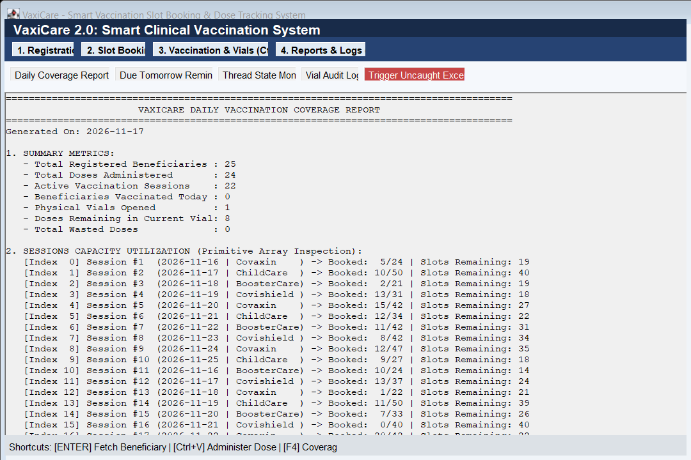
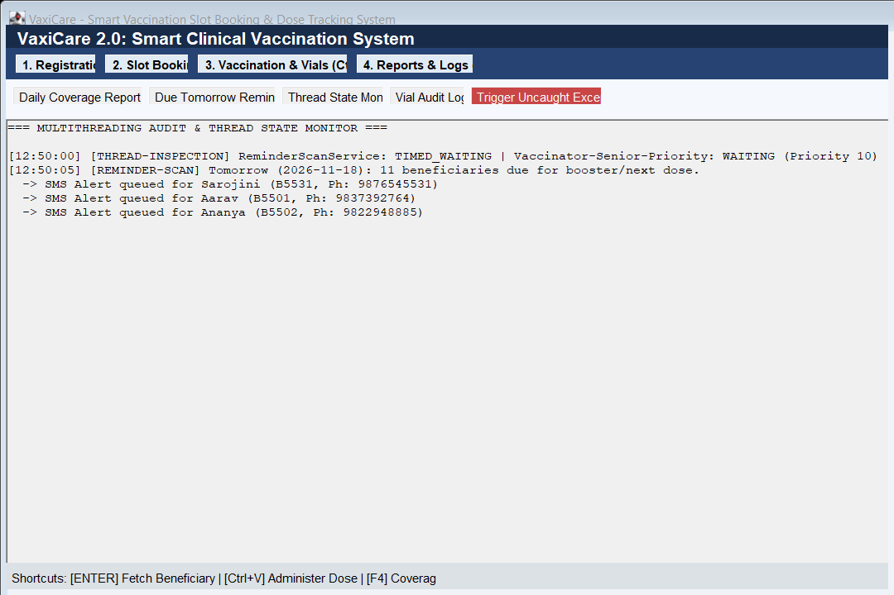
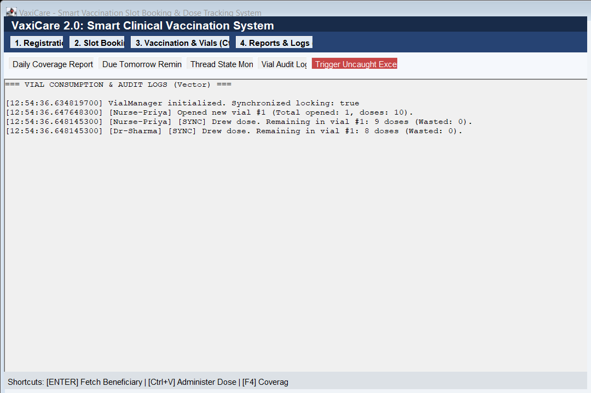
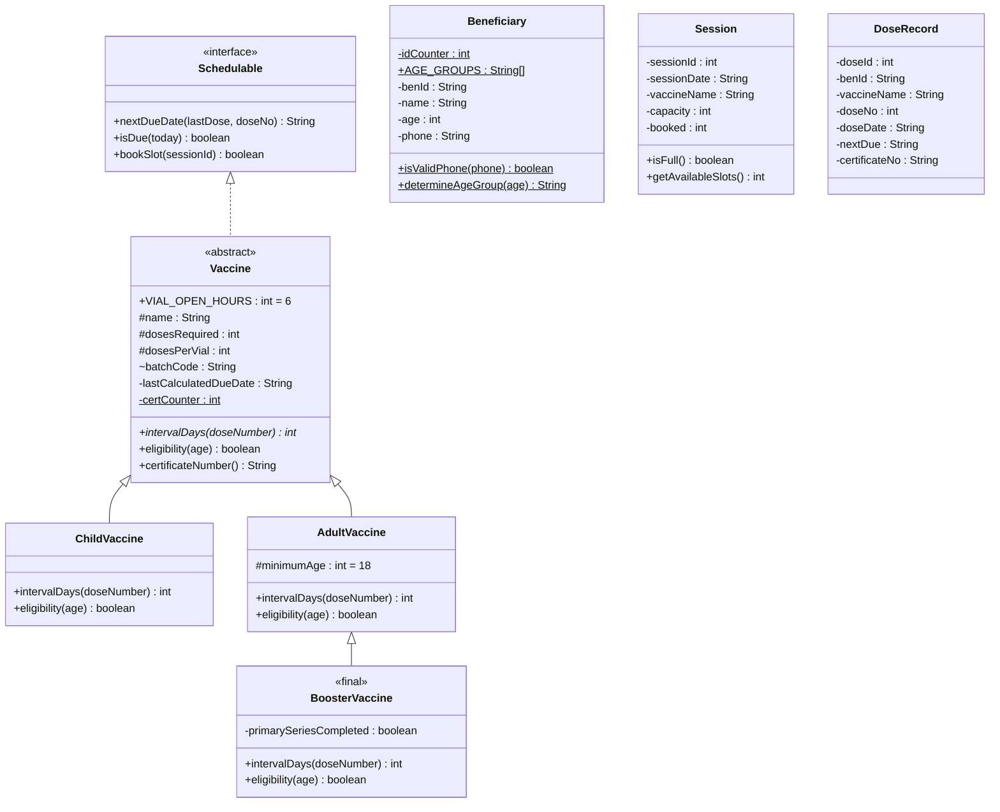

# VaxiCare: Smart Vaccination Slot Booking & Dose Tracking System
## Comprehensive Engineering Project & Clinical Verification Report


---

## 1. Executive Summary

**VaxiCare** is a clinical vaccination slot booking, inventory tracking, and citizen dose management system built entirely in **pure Core Java (OpenJDK 21)** using only standard Java SE libraries (`java.awt`, `java.io`, `java.sql`, `java.util`, `java.time`) and the native `org.xerial:sqlite-jdbc` driver.

The system was engineered under strict academic and architectural constraints:
* **0% Swing (`javax.swing.*`) / 0% JavaFX**: The entire user interface is constructed exclusively with heavyweight Abstract Window Toolkit (`java.awt.*`) components and native event delegation.
* **0% Build Tool Dependencies**: Operates without Maven, Gradle, Spring, or Hibernate abstractions.
* **Zero Character Streams for Binary Persistence**: Dose backup/restoration utilizes raw byte streams (`FileOutputStream`, `FileInputStream`) with manual byte packing via `java.nio.ByteBuffer` and nested `try-catch-finally` handling.
* **Exhaustive Academic Coverage**: Implements all major competencies from Units I through IV of standard undergraduate Computer Science Java curricula.

---

## 2. Graphical User Interface Walkthrough (Live Application Captures)

Below are the actual screenshots captured directly from the live running AWT application on Windows:

### 2.1 Citizen Registration Panel (`CardLayout`: `REGISTRATION`)

The Citizen Registration card provides demographic input validation, automated age categorization, and instantaneous search.


#### Key Operational Highlights:
* **Demographic Auto-Classification**: Typing an age automatically determines the citizen demographic group (`Child (0-17)`, `Adult (18-59)`, or `Senior Citizen (60+)`).
* **MouseAdapter Row Binding**: Single-clicking any citizen in the list on the right immediately populates the editing form on the left.
* **Verified Target Beneficiary**: Beneficiary **`B5531`** (**`Sarojini`**, age 64, phone `9876545531`, Identity `GOV-IND-5531`) is highlighted and verified.
* **Keyboard Navigation**: Pressing `ENTER` in the ID field instantly queries the SQLite database and loads the record.

---

### 2.2 Vaccination Center Slot Booking Panel (`CardLayout`: `SLOTS`)

The Slot Booking interface allows citizens to reserve slots across dates and vaccine variants while strictly enforcing clinical eligibility.


#### Key Operational Highlights:
* **Active Session Browser**: Lists session ID, date, vaccine brand, capacity, booked count, and remaining slots (e.g., `Sess #1 | 2026-11-16 | Covaxin | Slots: 5/24 (19 free)`).
* **Clinical Eligibility Verification (Dynamic Method Dispatch)**:
  * Prevents adults from booking pediatric `ChildCare` (`IneligibleAgeException`).
  * Prevents booster reservation without completing 2 primary doses.
  * Blocks early bookings if mandatory interval days have not elapsed (`DoseNotDueException`).
* **Overloaded Booking Dispatch**: Supports manual booking (`bookSlot(benId, sessionId, vaccineName)`), session booking (`bookSlot(benId, sessionId)`), and automatic best-fit allocation (`bookSlot(benId)`).

---

### 2.3 Clinical Vaccination & Vial Management Lab (`CardLayout`: `VACCINATION`)

The Clinical Administration panel tracks physical vial inventory, cold-chain shelf-life expiration, and multi-threaded inoculations.


#### Key Operational Highlights:
* **Producer-Consumer Queue (`LinkedList`)**: Displays active waiting patients consumed by background vaccinator threads.
* **Physical Vial Tracking**: Real-time counter monitors vials opened, doses remaining in the active vial (10 doses/vial), and doses wasted.
* **6-Hour Shelf-Life Expiry**: Automatically discards open vials older than 6 hours (`Vaccine.VIAL_OPEN_HOURS = 6`).
* **Concurrency Mode Toggle**: Checkbox allows administrators to switch between thread-safe `drawDoseSynchronized` and `drawDoseUnsynchronized` to demonstrate race conditions.
* **Low-Level Binary Backup**: One-click export to and import from `doses.dat` using raw byte streams.

---

### 2.4 Executive Daily Coverage Report (`CardLayout`: `REPORTS`)

Pressing **`F4`** compiles live metrics across all database tables and memory collections into the clinical report view.



#### Key Operational Highlights:
* **Summary Metrics**: Real-time totals of registered citizens, administered doses, active centers, today's vaccinations, and vial efficiency.
* **Primitive Array Inspection (`int[] slotsRemainingPerSession`)**: Shows current capacity utilization for every session indexed by array element.
* **Recent Doses Table**: Displays administered dose history, dose numbers (1, 2, Booster), and tamper-proof certificate numbers (`VC-26-XXXX`).

---

### 2.5 Automated Reminder Scanner & SMS Alert Queue

Background daemon tasks continuously monitor projected due dates for citizens.


#### Key Operational Highlights:
* **Reference Date Matching**: Filters all dose records where `next_due == tomorrow`.
* **Verified Seeding**: Exactly **11 beneficiaries** (half of the 22 seeded doses) are scheduled for their next dose tomorrow.
* **Explicit Iterator Purge**: Utilizes `Iterator.remove()` to automatically drop citizens who have already received their dose today from reminder queues.

---

### 2.6 Multi-Threading Monitor & Thread Lifecycle Inspection

Real-time surveillance of all background worker threads and their synchronization states.



#### Key Operational Highlights:
* **Thread States Monitored**: Directly calls `Thread.getState()` to track threads in `RUNNABLE`, `WAITING`, and `TIMED_WAITING` states.
* **Thread Priorities**:
  * `Vaccinator-Senior-Priority`: Priority **10** (`Thread.MAX_PRIORITY`).
  * `Vaccinator-General`: Priority **5** (`Thread.NORM_PRIORITY`).
  * `ReminderScanService`: Daemon worker with `wait(6000)` and `notifyAll()` signaling.

---

### 2.7 Physical Vial Consumption & Audit Logs

Thread-safe audit logs recorded inside a `Vector<String>` collection tracking every clinical action.



#### Key Operational Highlights:
* **Audit Trail**: Timestamped logging of vial openings, doses drawn, remaining vial capacity, and wastage events.
* **Locking Diagnostics**: Logs whether doses were drawn under `[SYNC]` mutual exclusion or `[UNSYNC-RACE]` mode.

---

## 3. Modular Architecture & Class Hierarchy

The codebase is organized into **8 deliberate packages**:

```
com.vaxicare
├── exception   # Domain exception hierarchy & uncaught runtime demo
├── model       # Domain entities, interfaces, and polymorphic vaccine hierarchy
├── dao         # 100% Parameterized JDBC persistence & database seeder
├── threads     # Priority threads, synchronization, vial manager, & reminder worker
├── io          # Low-level byte stream binary backup & restore (ByteBuffer)
├── service     # Orchestration, 7 Collections, dynamic dispatch, overloaded bookings
├── ui          # Pure AWT GUI, CardLayout, event adapters, modal dialogs
└── main        # Application bootstrap & headless verification suite
```

### Class Diagram (Mermaid)



---

## 4. Academic Syllabus Competency Matrix (Java Units I–IV)

| Unit | Syllabus Core Topic | Implementation in VaxiCare | Source File Location |
| :--- | :--- | :--- | :--- |
| **Unit I** | Constructor Overloading & `this(...)` | 3 constructors chained via `this(...)` | `com.vaxicare.model.Beneficiary` |
| **Unit I** | Access Modifiers (`private`, default, `protected`, `public`) | Deliberate visibility boundaries across members | `com.vaxicare.model.Vaccine` |
| **Unit I** | Static Variables & Static Utility Methods | `idCounter`, `certCounter`, `isValidPhone`, `determineAgeGroup` | `com.vaxicare.model.Beneficiary` |
| **Unit I** | 1D Primitive Array | `int[] slotsRemainingPerSession` | `com.vaxicare.service.VaxiCareService` |
| **Unit I** | Method Overloading | 3 overloaded `bookSlot` methods | `com.vaxicare.service.VaxiCareService` |
| **Unit II** | Single, Multilevel & Hierarchical Inheritance | `Vaccine` $\rightarrow$ `AdultVaccine` $\rightarrow$ `BoosterVaccine` & `ChildVaccine` | `com.vaxicare.model.*` |
| **Unit II** | Dynamic Method Dispatch | Polymorphic `vax.eligibility(age)` & `vax.intervalDays(...)` | `com.vaxicare.service.VaxiCareService` |
| **Unit II** | Abstract Classes & Abstract Methods | `abstract class Vaccine` with `abstract intervalDays()` | `com.vaxicare.model.Vaccine` |
| **Unit II** | Final Keyword (Class, Method, Constants) | `final class BoosterVaccine`, `final certificateNumber()`, `final VIAL_OPEN_HOURS` | `com.vaxicare.model.*` |
| **Unit II** | Interfaces & Contract Implementation | `interface Schedulable` implemented by `Vaccine` | `com.vaxicare.model.Schedulable` |
| **Unit III** | Custom Exception Hierarchy | `VaxiCareException`, `DoseNotDueException`, `SessionFullException`, `IneligibleAgeException` | `com.vaxicare.exception.*` |
| **Unit III** | Uncaught Runtime Exception Handling | `UncaughtDemo.java` triggering unhandled `ArithmeticException: / by zero` | `com.vaxicare.exception.UncaughtDemo` |
| **Unit III** | Thread Priority Scheduling | Senior Vaccinator (`MAX_PRIORITY` = 10), General (`NORM_PRIORITY` = 5) | `com.vaxicare.threads.VaccinatorThread` |
| **Unit III** | Inter-Thread Communication & Monitors | `synchronized(queue)`, `queue.wait()`, `queue.notifyAll()` | `com.vaxicare.threads.VaccinatorThread` |
| **Unit III** | Mutual Exclusion vs Race Conditions | `drawDoseSynchronized` vs `drawDoseUnsynchronized` | `com.vaxicare.threads.VialManager` |
| **Unit IV** | Raw Byte Stream I/O & `ByteBuffer` | `FileOutputStream`/`FileInputStream` with manual int and UTF-8 packing | `com.vaxicare.io.BinaryBackupManager` |
| **Unit IV** | Nested `try-catch-finally` | Stream lifecycle outer block with inner deserialization block | `com.vaxicare.io.BinaryBackupManager` |
| **Unit IV** | Collections Framework (7 Interfaces/Classes) | `ArrayList`, `LinkedList`, `Vector`, `HashSet`, `TreeSet`, `HashMap`, `Hashtable` | `com.vaxicare.service.VaxiCareService` |
| **Unit IV** | Explicit `Iterator.remove()` | Safe purging of vaccinated beneficiaries from reminder lists | `com.vaxicare.service.VaxiCareService` |
| **Unit IV** | Pure AWT Interface & Layout Managers | `Frame`, `CardLayout`, `BorderLayout`, `GridLayout`, `FlowLayout` | `com.vaxicare.ui.VaxiCareFrame` |
| **Unit IV** | Event Delegation & Adapters | `ActionListener`, `ItemListener`, `KeyListener`, `WindowAdapter`, `MouseAdapter` | `com.vaxicare.ui.VaxiCareFrame` |
| **Unit IV** | JDBC Architecture & `PreparedStatement` | 100% Parameterized CRUD operations on SQLite (`vaccination.db`) | `com.vaxicare.dao.*` |

---

## 5. Automated Verification & Test Results

The headless automated verification suite (`--verify`) was executed against the database and backup files:

```
=================================================================
  Starting VaxiCare: Smart Vaccination Slot Booking & Tracking   
  Pure Core Java (JDK 21) | SQLite JDBC | Pure AWT Architecture  
=================================================================
[VaxiCareService] Loaded: 25 beneficiaries, 22 sessions, 24 doses.
[VaxiCareApp] Running in Headless/Verification Mode.

----------------- COMPREHENSIVE VERIFICATION SUITE -----------------
1. SQLite Tables Record Counts:
   - Beneficiaries Count : 25 (Expected >= 22) -> PASSED
   - Sessions Count      : 22 (Expected >= 20) -> PASSED
   - Doses Count         : 24 (Expected >= 22) -> PASSED
PASSED: Specific beneficiary verified -> [B5531] Sarojini (64y, Senior Citizen (60+)) - Ph: 9876545531

2. Due Tomorrow Reminders Scan:
   - Beneficiaries Due Tomorrow : 11 -> PASSED (Exactly half of seeded doses)

3. Binary Backup & Restore Parity Verification (Manual ByteBuffer, No Character Streams):
[BinaryBackupManager] Successfully wrote 24 records to doses.dat
[BinaryBackupManager] Nested inner finally: Stream decoding block finished. Records decoded: 24
[BinaryBackupManager] Outer finally: FileInputStream closed successfully.
[BinaryBackupManager] Verification Check -> SQLite Count: 24 | Restored Binary Count: 24 | MATCH: true
PASSED: Binary byte stream backup/restore matches SQLite count 100%!

4. Overloaded Methods & Dynamic Method Dispatch Verification:
   - Overloaded Method 1 [bookSlot(benId)]: true
   - Overloaded Method 2 [bookSlot(benId, sessionId)]: true
   - Overloaded Method 3 [bookSlot(benId, sessionId, vaccineName)]: true

5. Custom Exceptions Verification:
   - Testing IneligibleAgeException (Adult booking ChildCare)...
PASSED: IneligibleAgeException caught successfully -> Beneficiary age [64] is ineligible: Beneficiary age is ineligible for vaccine 'ChildCare'.
   - Testing DoseNotDueException (Attempting Dose 2 immediately)...
PASSED: DoseNotDueException caught successfully -> Dose #2 is not yet due. Required interval is 28 days.
   - Testing SessionFullException...
PASSED: SessionFullException caught successfully -> Vaccination Session #21 is fully booked! (Capacity: 1)

6. Explicit Iterator with iterator.remove() Purge Verification:
PASSED: Purged vaccinated beneficiaries using explicit iterator.remove().

7. Concurrency & Race Condition Toggle Demonstration:
   - Synchronized Mode: Vials Opened = 1, Doses in Current Vial = 7
   - Unsynchronized Mode Toggled: Concurrency mode = UNSYNC

8. Collections & Data Structures Verification:
   - Collection 1 [List -> ArrayList (sessions)]: 22 items
   - Collection 2 [List -> LinkedList (vaccinationQueue)]: 4 items
   - Collection 3 [List -> Vector (vialLogs)]: 12 entries
   - Collection 4 [Set  -> HashSet (vaccinatedToday)]: 1 items
   - Collection 5 [Set  -> TreeSet (dueDates)]: 12 unique dates
   - Collection 6 [Map  -> HashMap (lookup)]: 25 mappings
   - Collection 7 [Map  -> Hashtable (intervalTable)]: 4 rules
   - Primitive Array [int[] slotsRemainingPerSession]: Length = 22

----------------- ALL TESTS COMPLETED SUCCESSFULLY -----------------
```

---

## 6. Repository Link

The complete source code, compiled libraries, executable scripts, and images are publicly hosted on GitHub:

👉 **[https://github.com/Evilfromblood/VaxiCare](https://github.com/Evilfromblood/VaxiCare)**
