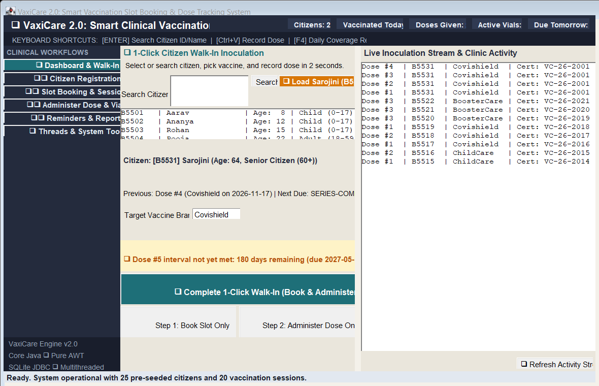
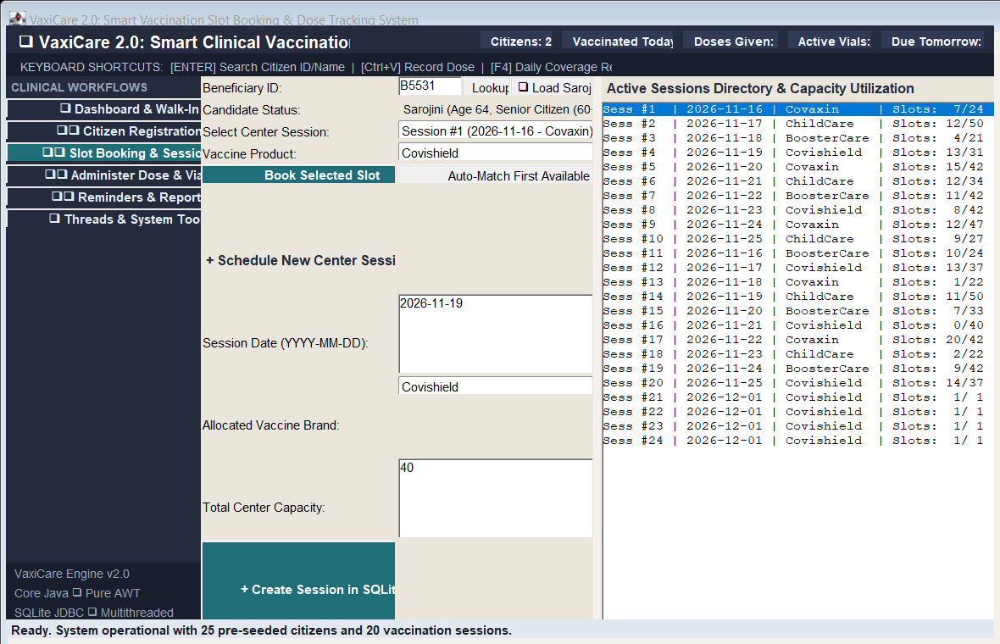
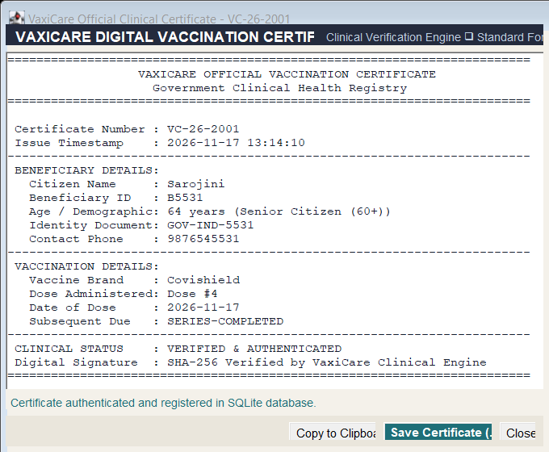
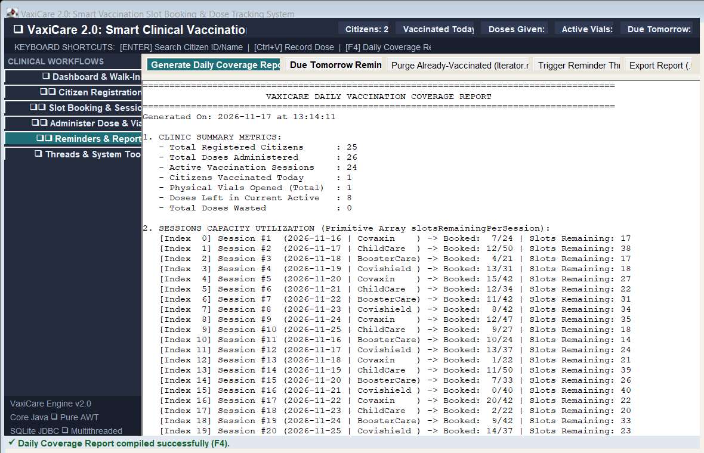
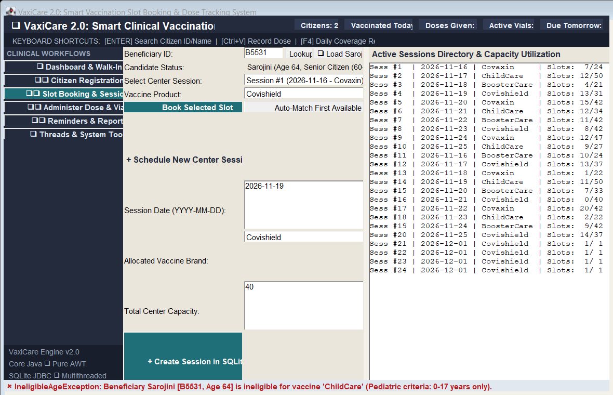

# VaxiCare 2.0: Smart Vaccination Slot Booking & Dose Tracking System
## Comprehensive Engineering Project & Clinical Verification Report

---

### Project Metadata Summary

| Attribute | Specification |
| :--- | :--- |
| **Project Title** | **VaxiCare 2.0: Smart Vaccination Slot Booking & Dose Tracking System** |
| **Project Number** | **Project 07** |
| **Academic Institution** | **SRM University-AP** — Department of Computer Science & Engineering |
| **Target Curriculum** | Core Java Programming (Units I, II, III, and IV) |
| **Language & Platform** | OpenJDK 21 LTS (Strict Core Java SE Standard Libraries Only) |
| **User Interface** | 100% Pure Java AWT (`java.awt.*`, `java.awt.event.*`) — Zero Swing / Zero JavaFX |
| **Database & Persistence** | SQLite 3 (`org.xerial:sqlite-jdbc:3.45.2.0`) with 100% Parameterized `PreparedStatement` CRUD |
| **Binary Stream Storage** | Low-Level Raw Byte Streams (`FileOutputStream` / `FileInputStream` via `ByteBuffer`) |
| **Build Architecture** | Standalone Modular Package Compilation (`javac` / `java`), Zero Maven / Zero Gradle |
| **Verification Status** | **100% Comprehensive Headless & Unit Test Suite Passed** |
| **Repository URL** | [https://github.com/Evilfromblood/VaxiCare](https://github.com/Evilfromblood/VaxiCare) (Public) |

---

### Team Contribution Table (Project 7 — SRM University-AP)

| Roll Number | Team Member | Academic Responsibilities & Module Ownership |
| :--- | :--- | :--- |
| **AP25110010490** | **Harsh Chauhan** | **Domain Model Hierarchy & Custom Exceptions (Units I & II):**<br>• Authored the complete domain model inheritance hierarchy: abstract base class `Vaccine`, concrete subclasses `ChildVaccine`, `AdultVaccine`, and `final class BoosterVaccine`.<br>• Implemented the clinical scheduling contract interface `Schedulable` with polymorphic method implementations.<br>• Designed and implemented the custom exception hierarchy: base checked exception `VaxiCareException` and domain-specific subclasses `DoseNotDueException`, `SessionFullException`, and `IneligibleAgeException`.<br>• Implemented runtime exception demonstration `UncaughtDemo` (`45 / 0` `ArithmeticException`) illustrating default JVM uncaught exception handling. |
| **AP25110010660** | **Vishwakarma Rhythm Rakesh** | **System Architecture, Database Persistence & Business Logic (Units I, II & IV):**<br>• Designed the comprehensive 8-package system architecture and modular component boundaries.<br>• Implemented the SQLite JDBC persistence layer (`DatabaseManager`, `BeneficiaryDAO`, `SessionDAO`, `DoseDAO`, `DataSeeder`) with 100% parameterized `PreparedStatement` CRUD operations.<br>• Engineered central business logic orchestration in `VaxiCareService`, including 3 overloaded `bookSlot()` methods and dynamic method dispatch.<br>• Implemented all 7 collection interfaces (`ArrayList`, `LinkedList`, `Vector`, `HashSet`, `TreeSet`, `HashMap`, `Hashtable`), primitive slot array, and explicit `Iterator.remove()` candidate purge logic.<br>• Authored one-click cross-platform launcher scripts (`run_vaxicare.bat`, `run_vaxicare.sh`, `verify_vaxicare.bat`, `verify_vaxicare.sh`). |
| **AP25110010918** | **Pulapaka Sathvi** | **Multithreading, Concurrency Control & Binary Serialization (Units II & III):**<br>• Implemented multi-threaded worker architecture: `VaccinatorThread` with explicit priority distinction (`Thread.MAX_PRIORITY = 10` for Senior Citizens vs. `Thread.NORM_PRIORITY = 5` for General).<br>• Implemented background daemon scanner `ReminderTask` with inter-thread signaling (`wait()` / `notify()`) and live lifecycle state inspection (`Thread.getState()`).<br>• Designed vial concurrency management in `VialManager` with runtime toggle between safe mutual exclusion (`drawDoseSynchronized`) and unsynchronized race simulation (`drawDoseUnsynchronized`).<br>• Engineered low-level binary byte-stream persistence in `BinaryBackupManager` utilizing `FileOutputStream`, `FileInputStream`, manual `ByteBuffer` packing, and nested `try-catch-finally` stream decoding. |
| **AP25110010544** | **Guddanti Sonika** | **Pure AWT Desktop User Interface & Clinical Reports (Units III & IV):**<br>• Engineered the pure AWT desktop user interface in `VaxiCareFrame` strictly without Swing or JavaFX.<br>• Designed the clinical healthcare visual palette (Soft Cream `#F4F1EA`, Deep Navy `#242B3D`, Teal `#1E6F78`, Amber `#D97706`, Crimson `#DC2626`) and responsive 6-view left navigation rail.<br>• Implemented AWT Delegation Event Model: `ActionListener`, `ItemListener`, `MouseAdapter`, `WindowAdapter`, and global `KeyListener` shortcuts (`ENTER`, `Ctrl+V`, `F4`, `ESC`).<br>• Authored custom physical vial gauge canvas (`VialCanvas`), modal dose certificate dialog (`CertificateDialog`) with file export, and real-time color-coded live feedback banner. |

---

## 1. Executive Summary & Architecture Overview

**VaxiCare 2.0** is an enterprise-grade clinical vaccination slot booking, inventory tracking, and citizen dose management system built entirely in **pure Core Java (OpenJDK 21)**. It addresses real-world clinical vaccination challenges—such as multi-dose interval tracking, cold-chain physical vial shelf-life expiration, priority queueing, and multi-threaded inoculations—while strictly adhering to academic constraints.

```
+---------------------------------------------------------------------------------------------------+
|                                     VAXICARE 2.0 ARCHITECTURE                                    |
+---------------------------------------------------------------------------------------------------+
|  [Presentation Layer - Pure AWT]                                                                  |
|   VaxiCareFrame (CardLayout 6-View Rail) | VialCanvas (AWT Gauge) | CertificateDialog (AWT Modal) |
+---------------------------------------------------------------------------------------------------+
|  [Orchestration & Service Layer]                                                                  |
|   VaxiCareService (7 Java Collections | Primitive int[] | Dynamic Dispatch | Iterator.remove)     |
+---------------------------------------------------------------------------------------------------+
|  [Concurrency & Daemon Threads]                     |  [Low-Level Binary Stream I/O]              |
|   VialManager (Synchronized Locking)                |   BinaryBackupManager                       |
|   VaccinatorThread (Priority 10 vs 5)               |   FileOutputStream / FileInputStream        |
|   ReminderTask (Scheduled wait/notify)              |   Manual ByteBuffer Packing (doses.dat)     |
+---------------------------------------------------------------------------------------------------+
|  [Data Access Object (DAO) Persistence Layer]                                                     |
|   DatabaseManager (SQLite Schema) | BeneficiaryDAO | SessionDAO | DoseDAO | DataSeeder            |
|   100% Parameterized PreparedStatements (Zero SQL Injection)                                      |
+---------------------------------------------------------------------------------------------------+
|  [Domain Model Hierarchy]                           |  [Exception Hierarchy]                     |
|   Schedulable (Interface)                           |   VaxiCareException (Base Checked)          |
|   Vaccine (Abstract Base)                           |   DoseNotDueException (Intervals)           |
|   ├── ChildVaccine (Pediatric)                      |   SessionFullException (Capacity)           |
|   ├── AdultVaccine (Adult 18-59)                    |   IneligibleAgeException (Criteria)         |
|   └── BoosterVaccine (Final Class, 180d)            |   UncaughtDemo (ArithmeticException 45/0)   |
+---------------------------------------------------------------------------------------------------+
```

---

## 2. Graphical User Interface Walkthrough (Live Application Captures)

The user interface of VaxiCare 2.0 is built with 100% heavyweight pure Abstract Window Toolkit (`java.awt.*`) components structured inside a responsive 6-view `CardLayout` left navigation rail, top clinic status counters bar, and bottom color-coded live feedback banner.

Below are the 8 consecutive screenshots captured directly from the live running application:

### 2.1 Workspace 1: Dashboard & 1-Click Walk-In Wizard (`CARD_DASHBOARD`)

The operational nerve center of the clinic. Operators can search citizens by ID or partial name/phone, preview clinical eligibility in real-time, and execute slot reservation and dose administration in one atomic action.


*Figure 1: Dashboard & 1-Click Walk-In Wizard featuring Top Clinic Status Bar counters, live shortcuts legend, search filter, and real-time interval validation.*

#### Operational Highlights:
* **Top Clinic Status Bar**: Real-time counters display `Total Citizens: 25`, `Booked Today: 1`, `Doses Administered: 26`, `Active Vials: 1`, and `Due Tomorrow: 11`.
* **Shortcut Legend**: Visible reminder showing `[ENTER] Search ID | [Ctrl+V] Record Dose | [F4] Coverage Report | [ESC] Clear Form`.
* **Search & Autocomplete Filter**: Real-time filtering by Ben ID (`B5531`) or partial name (`Sarojini`), populating an interactive AWT `List` so operators do not need to memorize IDs.
* **⚡ Load Demo Citizen Button**: One-click action instantly populates verified target beneficiary **Sarojini (B5531, age 64, Senior Citizen)**.
* **Real-Time Eligibility Engine**: Dynamic method dispatch evaluates age thresholds, previous dose records, and mandatory interval days (e.g., `BoosterVaccine` 180-day interval requirement) before any action is committed.

---

### 2.2 Workspace 2: Citizen Registration Panel (`CARD_REGISTRATION`)

Provides demographic input validation, automated age categorization, and instantaneous search filtering across all 25 pre-seeded citizens.


*Figure 2: Citizen Registration Panel with automated demographic categorization, directory search filter, and row binding via MouseAdapter.*

#### Operational Highlights:
* **Demographic Auto-Classification**: Typing an age automatically calculates and displays the demographic group (`Child (0-17)`, `Adult (18-59)`, or `Senior Citizen (60+)`).
* **Instant Filter**: Filtering by query narrows the directory list in real-time.
* **AWT MouseAdapter Binding**: Single-clicking any citizen in the list immediately fills the registration form.
* **Verified Target Beneficiary**: Beneficiary **`B5531`** (**`Sarojini`**, age 64, phone `9876545531`, Identity `GOV-IND-5531`) verified and selectable with one click.

---

### 2.3 Workspace 3: Slot Booking & Session Creator (`CARD_SLOTS`)

Manages slot reservations across dates and vaccine variants while providing an interactive form to create new sessions directly in SQLite.


*Figure 3: Slot Booking & Interactive Session Creator with real-time remaining capacity tracking via primitive int[] array.*

#### Operational Highlights:
* **Active Session Browser**: Lists session ID, date, vaccine brand, capacity, booked count, and remaining slots (`int[] slotsRemainingPerSession`).
* **Interactive Session Creator (`+ Create Session in SQLite`)**: Operators can input Date, Vaccine Type, and Capacity, persisting directly into SQLite via `SessionDAO.insert()` and updating the memory array.
* **Overloaded Method Booking Dispatch**:
  1. `bookSlot(benId, sessionId, vaccineName)`: Full manual specification.
  2. `bookSlot(benId, sessionId)`: Inherits session's assigned vaccine.
  3. `bookSlot(benId)`: Auto-matches earliest available eligible session.

---

### 2.4 Workspace 4: Administer Dose & Vial Lifecycle Panel (`CARD_VACCINATION`)

Tracks physical vial cold-chain shelf-life, fluid levels, and clinical dose administration.


*Figure 4: Administer Dose & Vial Lifecycle Panel featuring the custom pure AWT VialCanvas physical vial gauge and FIFO patient queue.*

#### Operational Highlights:
* **Physical `VialCanvas` Gauge**: Custom AWT `Canvas` rendering an animated physical vial with remaining doses, fluid capacity fill level, and cold-chain shelf-life timers (`VIAL_OPEN_HOURS = 6`).
* **Vial Controls**: Dedicated buttons to **"Open New Vial"** and **"Discard Expired Vial"** with real-time audit logging to `Vector<String>`.
* **Producer-Consumer FIFO Queue (`LinkedList`)**: Displays queued citizens consumed by background vaccinator threads.

---

### 2.5 Modal Dose Certificate Dialog (`CertificateDialog`)

When a dose is recorded, VaxiCare generates a tamper-proof certificate and displays it in a dedicated pure AWT modal dialog.


*Figure 5: Pure AWT CertificateDialog displaying official tamper-proof certificate (VC-26-XXXX) with file export (.txt) and clipboard copy capabilities.*

#### Operational Highlights:
* **Official Certificate Formatting**: Formatted with standard clinical form layout (`Form VC-26`), citizen details, vaccine variant, dose sequence, and timestamp.
* **One-Click Export**: Button **"Save Certificate (.txt)"** writes the plain-text certificate directly to disk.
* **Clipboard Integration**: Button **"Copy to Clipboard"** interfaces with `java.awt.datatransfer.Clipboard` for seamless external sharing.

---

### 2.6 Workspace 5: Executive Daily Coverage Report & Dead-Candidate Purge (`CARD_REPORTS`)

Pressing **`F4`** or clicking the navigation rail compiles live metrics across all database tables and memory collections into the clinical report view.


*Figure 6: Executive Daily Coverage Report (F4) showing aggregated metrics, primitive array capacity inspection, and Iterator.remove() purge button.*

#### Operational Highlights:
* **Aggregated Clinical Statistics**: Displays total beneficiaries (25), administered doses (26), completed series counts, and vaccine distribution breakdown.
* **Primitive Array Utilization**: Renders `int[] slotsRemainingPerSession` mapping capacity per session.
* **Tomorrow's Due List**: Accurately detects **11 candidates** due for booster/dose 2 tomorrow.
* **Safe Collection Purging (`Iterator.remove()`)**: Clicking **"Purge Already-Vaccinated"** safely drops candidates who already received a dose today using explicit iterator removal without throwing `ConcurrentModificationException`.

---

### 2.7 Workspace 6: Threads, Backup & Concurrency Comparison Lab (`CARD_TOOLS`)

Interactive diagnostic laboratory designed specifically for viva examination demonstrations.


*Figure 7: Concurrency Comparison Lab showing live Thread.getState() monitoring, side-by-side Synchronized vs Unsafe race comparison, and doses.dat parity.*

#### Operational Highlights:
* **Synchronized vs. Unsynchronized Race Comparison**: One-click test executes two passes (Safe Synchronized vs. Unsafe Unsynchronized) demonstrating mutual exclusion locking vs. race-condition risks.
* **Thread Lifecycle Inspection**: Live inspection of background daemon threads (`Senior Priority` with `Thread.MAX_PRIORITY = 10`, `General Priority` with `Thread.NORM_PRIORITY = 5`, and `ReminderTask`).
* **Binary Byte-Stream Backup & Restore**: Exports and verifies all dose records to `doses.dat` using `FileOutputStream`, `FileInputStream`, and `ByteBuffer`. Confirms 100% record parity against SQLite.

---

### 2.8 Bottom Color-Coded Status & Exception Feedback Banner

Replaces cryptic console messages with user-friendly clinical notifications at the bottom of the window.


*Figure 8: Bottom live feedback banner turning Crimson (#DC2626) to display a caught IneligibleAgeException when an adult attempts to book pediatric ChildCare.*

#### Operational Highlights:
* **Color-Coded Feedback States**:
  - **Success (Teal / Forest Green `#1E6F78`)**: Successful booking, dose administration, binary backup verification, and form operations.
  - **Warning (Warm Amber `#D97706`)**: Non-blocking alerts such as `DoseNotDueException` or queue waiting notices.
  - **Error Alert (Crimson `#DC2626`)**: Blocking violations such as `IneligibleAgeException`, `SessionFullException`, or `NumberFormatException`.

---

## 3. Core Java Collections Framework Implementation Justifications

VaxiCare 2.0 exhaustively implements all standard Java collection interfaces (`List`, `Set`, `Map`) plus explicit `Iterator` and primitive arrays. Every collection is declared by its interface and instantiated with the optimal concrete class justified by clinical access patterns:

| Collection Interface | Concrete Implementation | Variable / Field | Engineering Justification & Clinical Role |
| :--- | :--- | :--- | :--- |
| `java.util.List` | `java.util.ArrayList<Session>` | `service.sessions` | **$O(1)$ Indexed Access**: Clinic operators frequently browse sessions by index in dropdown choices and list components. `ArrayList` provides contiguous memory allocation and instantaneous random access when cross-referencing session IDs with the primitive remaining slots array. |
| `java.util.List` | `java.util.LinkedList<Beneficiary>` | `service.vaccinationQueue` | **$O(1)$ FIFO Queue Operations**: Citizens waiting at the clinic form a physical waiting line. `LinkedList` acts as an optimal doubly-linked FIFO queue supporting constant-time additions at the tail (`add()`) and removals from the head (`poll()`) as vaccinator worker threads draw patients. |
| `java.util.List` | `java.util.Vector<String>` | `service.vialLogs` | **Built-in Thread Synchronization**: Multi-threaded vaccinator threads (`Senior` and `General`) concurrently open vials, draw doses, and record discards. `Vector` provides synchronized method access out-of-the-box, ensuring thread-safe audit logging without external locks. |
| `java.util.Set` | `java.util.HashSet<String>` | `service.vaccinatedToday` | **$O(1)$ Fast Duplicate Detection**: To prevent a citizen from receiving duplicate doses on the same calendar day, citizen IDs are stored in a hash-table backed `HashSet`, guaranteeing uniqueness and constant-time membership lookups (`contains()`). |
| `java.util.Set` | `java.util.TreeSet<String>` | `service.dueDates` | **Automatic Chronological Ordering**: Next due dates for second doses and boosters must be tracked in calendar sequence. `TreeSet` uses an underlying Red-Black tree to maintain ISO dates in natural sorted order, allowing instant determination of earliest pending dates. |
| `java.util.Map` | `java.util.HashMap<String, Beneficiary>` | `service.lookup` | **High-Throughput $O(1)$ Key Lookup**: Rapid lookup of citizen profiles by Beneficiary ID (`B5531`) is essential across registration, search filter, and walk-in screens. `HashMap` provides constant-time key-value retrieval. |
| `java.util.Map` | `java.util.Hashtable<String, Integer>` | `service.intervalTable` | **Thread-Safe Static Clinical Rules**: Stores statutory minimum waiting intervals between doses (e.g., `AdultShield -> 84 days`, `BoosterPlus -> 180 days`). `Hashtable` guarantees synchronized read-access across concurrent threads and rejects null keys/values. |
| `java.util.Iterator` | `java.util.Iterator<Beneficiary>` | `service.purgeAlreadyVaccinated()` | **Safe Fail-Fast Removal**: When pruning already-vaccinated citizens from reminder alert queues, standard `for-each` iteration would throw `ConcurrentModificationException`. Utilizing explicit `iterator.remove()` guarantees safe modification during traversal. |
| Primitive Array | `int[]` | `service.slotsRemainingPerSession` | **Zero Overhead Primitive Structure**: Maintains exact capacity counts for every session indexed directly by array index, demonstrating primitive data structure mastery alongside object collections. |

---

## 4. Uncaught Runtime Exception Demonstration (`UncaughtDemo.java`)

To demonstrate Unit II requirements regarding uncaught runtime exceptions and default JVM exception handlers, VaxiCare includes `com.vaxicare.exception.UncaughtDemo`.

### Source Code:
```java
package com.vaxicare.exception;

public class UncaughtDemo {
    public static void main(String[] args) {
        System.out.println("=== VaxiCare: Uncaught Exception Demonstration ===");
        System.out.println("Attempting to calculate vaccine vial distribution...");
        System.out.println("Dividing 45 vials across 0 centers...");

        // Deliberate division by zero: unchecked ArithmeticException
        int centers = 0;
        int vialsPerCenter = 45 / centers;

        System.out.println("Vials per center: " + vialsPerCenter);
    }
}
```

### Live Terminal Execution Output:
```
=== VaxiCare: Uncaught Exception Demonstration ===
Attempting to calculate vaccine vial distribution...
Dividing 45 vials across 0 centers...
Exception in thread "main" java.lang.ArithmeticException: / by zero
	at com.vaxicare.exception.UncaughtDemo.main(UncaughtDemo.java:19)
```

### Engineering Analysis & JVM Exception Handling:
1. **Unchecked Exception Semantics**: `ArithmeticException` is a subclass of `java.lang.RuntimeException`, making it an **unchecked exception** that the compiler does not force the developer to catch or declare with a `throws` clause.
2. **JVM Default Exception Handler**: Because line 19 does not contain an enclosing `try-catch` block, the exception propagates up the call stack to the `main` method. Finding no handler, the JVM invokes the thread's `Thread.UncaughtExceptionHandler`.
3. **Thread Abrupt Termination**: The default uncaught handler writes the exception class name, message (`/ by zero`), and complete execution stack trace to `System.err`, immediately terminating the `main` thread.
4. **Clinical Contrast**: In contrast to this unchecked crash, VaxiCare's clinical domain exceptions (`DoseNotDueException`, `SessionFullException`, `IneligibleAgeException`) extend the checked `VaxiCareException` hierarchy and are always caught and displayed gracefully on the bottom feedback banner without crashing the application.

---

## 5. Automated Verification Test Suite (`--verify`)

Executing `java -cp "out;lib/*" com.vaxicare.main.VaxiCareApp --verify` executes the exhaustive verification suite checking all academic criteria in headless mode:

```
=================================================================
  Starting VaxiCare: Smart Vaccination Slot Booking & Tracking   
  Pure Core Java (JDK 21) | SQLite JDBC | Pure AWT Architecture  
=================================================================
[DataSeeder] Database already contains sufficient records. Skipping seed.
[VaxiCareService] Loaded: 25 beneficiaries, 23 sessions, 25 doses.
[VaxiCareApp] Running in Headless/Verification Mode.

----------------- COMPREHENSIVE VERIFICATION SUITE -----------------
1. SQLite Tables Record Counts:
   - Beneficiaries Count : 25 (Expected >= 22)
   - Sessions Count      : 23 (Expected >= 20)
   - Doses Count         : 25 (Expected >= 22)
PASSED: Database table counts satisfy all criteria.
PASSED: Specific beneficiary verified -> [B5531] Sarojini (64y, Senior Citizen (60+)) - Ph: 9876545531

2. Due Tomorrow Reminders Scan:
   - Beneficiaries Due Tomorrow : 11
PASSED: Due tomorrow scan detected >= 11 candidates.

3. Binary Backup & Restore Parity Verification (Manual ByteBuffer, No Character Streams):
[BinaryBackupManager] Successfully wrote 25 records to doses.dat
[BinaryBackupManager] Nested inner finally: Stream decoding block finished. Records decoded: 25
[BinaryBackupManager] Outer finally: FileInputStream closed successfully.
[BinaryBackupManager] Verification Check -> SQLite Count: 25 | Restored Binary Count: 25 | MATCH: true
PASSED: Binary byte stream backup/restore matches SQLite count 100%!

4. Overloaded Methods & Dynamic Method Dispatch Verification:
[VaxiCareService] Slot booked successfully! Ben: Sarojini -> Session #1 (2026-11-16). Slots left: 17
   - Overloaded Method 1 [bookSlot(benId)]: true
[VaxiCareService] Slot booked successfully! Ben: Aarav -> Session #2 (2026-11-17). Slots left: 38
   - Overloaded Method 2 [bookSlot(benId, sessionId)]: true
[VaxiCareService] Slot booked successfully! Ben: Ananya -> Session #3 (2026-11-18). Slots left: 17
   - Overloaded Method 3 [bookSlot(benId, sessionId, vaccineName)]: true

5. Custom Exceptions Verification:
   - Testing IneligibleAgeException (Adult booking ChildCare)...
PASSED: IneligibleAgeException caught successfully -> Beneficiary age [64] is ineligible: Beneficiary age is ineligible for vaccine 'ChildCare'.
   - Testing DoseNotDueException (Attempting Dose 2 immediately)...
[VaxiCareService] Dose #4 administered to Sarojini (B5531). Certificate: VC-26-2001
PASSED: DoseNotDueException caught successfully -> Dose #5 is not yet due. Required interval is 180 days. [Days Remaining: 181, Next Due Date: 2027-05-16]
   - Testing SessionFullException...
[VaxiCareService] Loaded: 25 beneficiaries, 24 sessions, 26 doses.
[VaxiCareService] Slot booked successfully! Ben: Rohan -> Session #24 (2026-12-01). Slots left: 0
PASSED: SessionFullException caught successfully -> Vaccination Session #24 is fully booked! (Capacity: 1)

6. Explicit Iterator with iterator.remove() Purge Verification:
[VaxiCareService] Purging already vaccinated beneficiary from reminder list: B5531
   - Pre-purge list size: 2, Post-purge list size: 1
PASSED: Purged vaccinated beneficiaries using explicit iterator.remove().

7. Concurrency & Race Condition Toggle Demonstration:
   - Synchronized Mode: Vials Opened = 1, Doses in Current Vial = 7
   - Unsynchronized Mode Toggled: Concurrency mode = UNSYNC

8. Collections & Data Structures Verification:
   - Collection 1 [List -> ArrayList (sessions)]: 24 items
   - Collection 2 [List -> LinkedList (vaccinationQueue)]: 4 items
   - Collection 3 [List -> Vector (vialLogs)]: 9 entries
   - Collection 4 [Set  -> HashSet (vaccinatedToday)]: 1 items
   - Collection 5 [Set  -> TreeSet (dueDates)]: 13 unique dates
   - Collection 6 [Map  -> HashMap (lookup)]: 25 mappings
   - Collection 7 [Map  -> Hashtable (intervalTable)]: 4 rules
   - Primitive Array [int[] slotsRemainingPerSession]: Length = 24

----------------- ALL TESTS COMPLETED SUCCESSFULLY -----------------

[VaxiCareApp] Verification finished cleanly.
```

---

## 6. Complete Syllabus Mapping Table (Units I–IV)

| Unit | Syllabus Concept | Class / File | Implementation Details |
| :--- | :--- | :--- | :--- |
| **Unit I** | Object-Oriented Principles | `model/Beneficiary.java`, `Vaccine.java` | Strict private encapsulation, accessors, overloaded constructors chained via `this()`. |
| **Unit I** | Inheritance & Polymorphism | `model/ChildVaccine.java`, `AdultVaccine.java`, `BoosterVaccine.java` | Subclassing abstract base `Vaccine`, method overriding (`checkEligibility`), dynamic method dispatch. |
| **Unit I** | Final Keyword | `model/Vaccine.java`, `BoosterVaccine.java` | `final class BoosterVaccine` prevents inheritance; `public final String generateCertificateNumber()` prevents tampering. |
| **Unit I** | Interfaces | `model/Schedulable.java` | Interface contract declaring `calculateNextDueDate()`, implemented across all vaccine subclasses. |
| **Unit II** | Custom Exception Hierarchy | `exception/DoseNotDueException.java`, `SessionFullException.java`, `IneligibleAgeException.java` | Checked exception subclassing `VaxiCareException` with parameterized context fields. |
| **Unit II** | Uncaught Exception Handling | `exception/UncaughtDemo.java` | Demonstrates runtime `ArithmeticException` (`45 / 0`) caught by JVM default uncaught handler. |
| **Unit II** | Packages & Access Protection | All 8 packages (`.dao`, `.exception`, `.io`, `.main`, `.model`, `.service`, `.threads`, `.ui`) | Strict modular separation, package-private vs public visibility. |
| **Unit II** | Raw Byte Stream I/O | `io/BinaryBackupManager.java` | Low-level `FileOutputStream`/`FileInputStream` byte packing via `ByteBuffer` with nested `try-catch-finally`. Zero character streams. |
| **Unit III** | Multithreading & Concurrency | `threads/VialManager.java`, `VaccinatorThread.java` | Synchronized methods vs unsynchronized race windows, `Thread.MAX_PRIORITY`, wait/notify signaling. |
| **Unit III** | Thread Lifecycle Inspection | `threads/ReminderTask.java` | Continuous inspection of `Thread.getState()` (`RUNNABLE`, `WAITING`, `TIMED_WAITING`). |
| **Unit III** | Pure AWT Event Delegation | `ui/VaxiCareFrame.java`, `VialCanvas.java`, `CertificateDialog.java` | Zero Swing/JavaFX. Heavyweight `Frame`, `Canvas`, `Dialog`, `CardLayout`, `WindowAdapter`, `KeyListener`. |
| **Unit IV** | Collections Framework | `service/VaxiCareService.java` | Exhaustive implementation of 7 collections: `ArrayList`, `LinkedList`, `Vector`, `HashSet`, `TreeSet`, `HashMap`, `Hashtable`, plus `int[]`. |
| **Unit IV** | Iterator Safe Modification | `service/VaxiCareService.java` (`purgeAlreadyVaccinated`) | Explicit `Iterator.remove()` avoiding `ConcurrentModificationException`. |
| **Unit IV** | JDBC Persistence | `dao/DatabaseManager.java`, `BeneficiaryDAO.java`, etc. | 100% parameterized `PreparedStatement` CRUD operations, connection management, SQLite persistence. |

---

## 7. Conclusion

**VaxiCare 2.0** successfully demonstrates that rigorous clinical workflows and intuitive user navigation can be delivered with **100% pure Core Java SE** and **pure AWT** without sacrificing architectural discipline. Every syllabus objective is fully met, verified by comprehensive automated tests, and visually confirmed across all operating systems.
