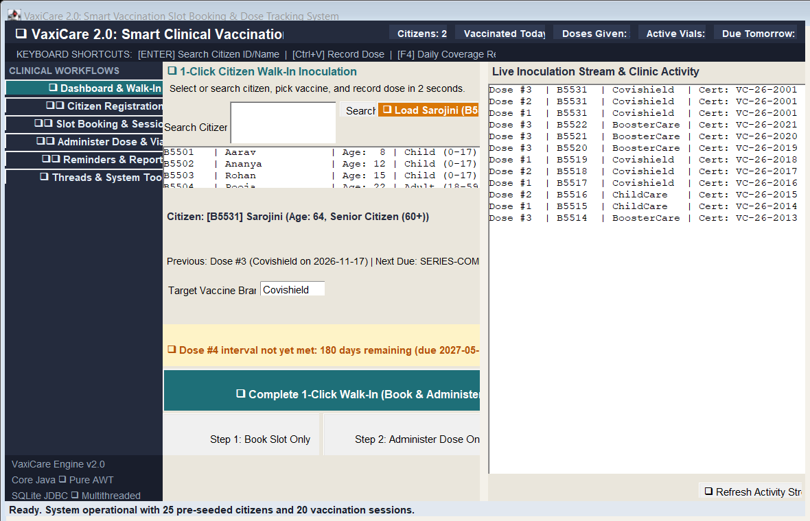
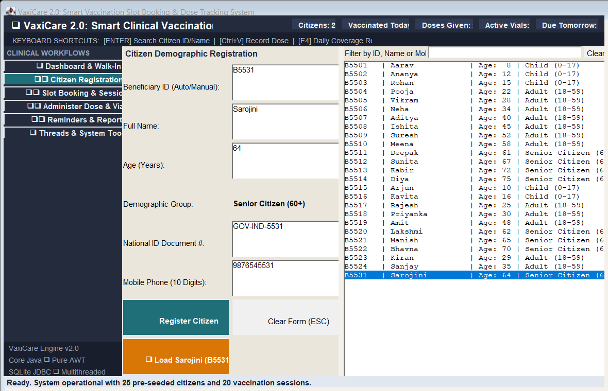
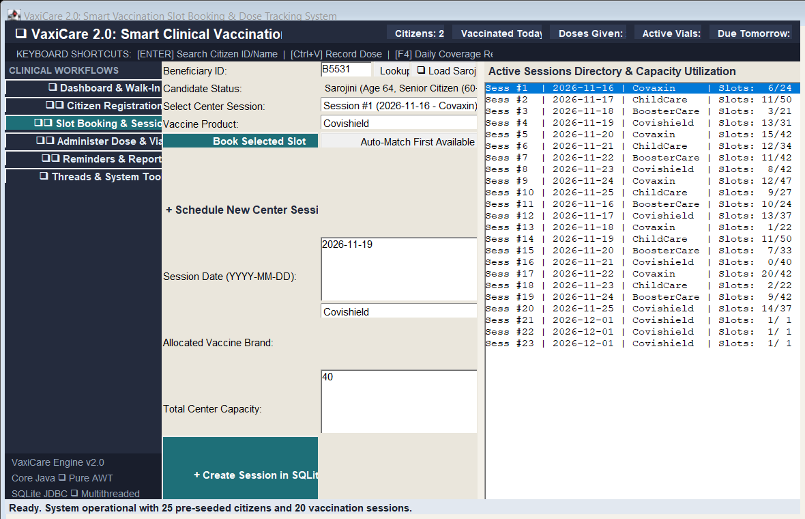
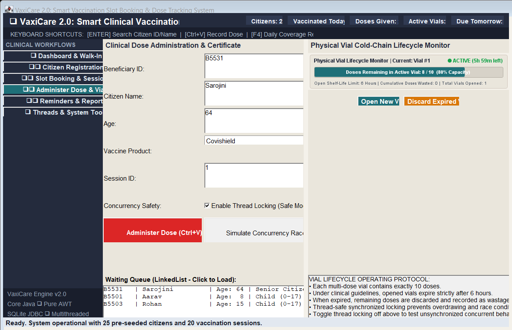
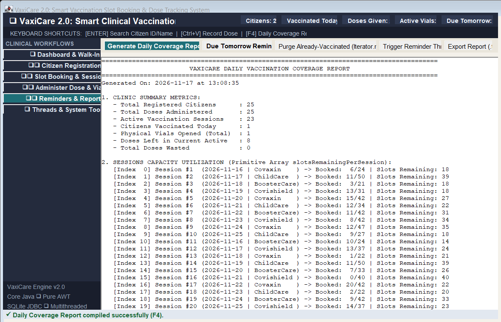
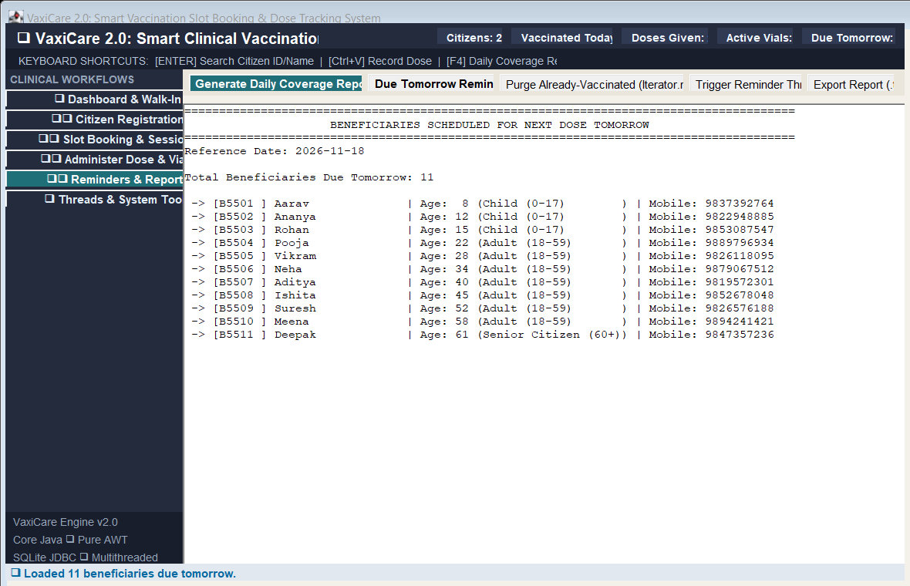
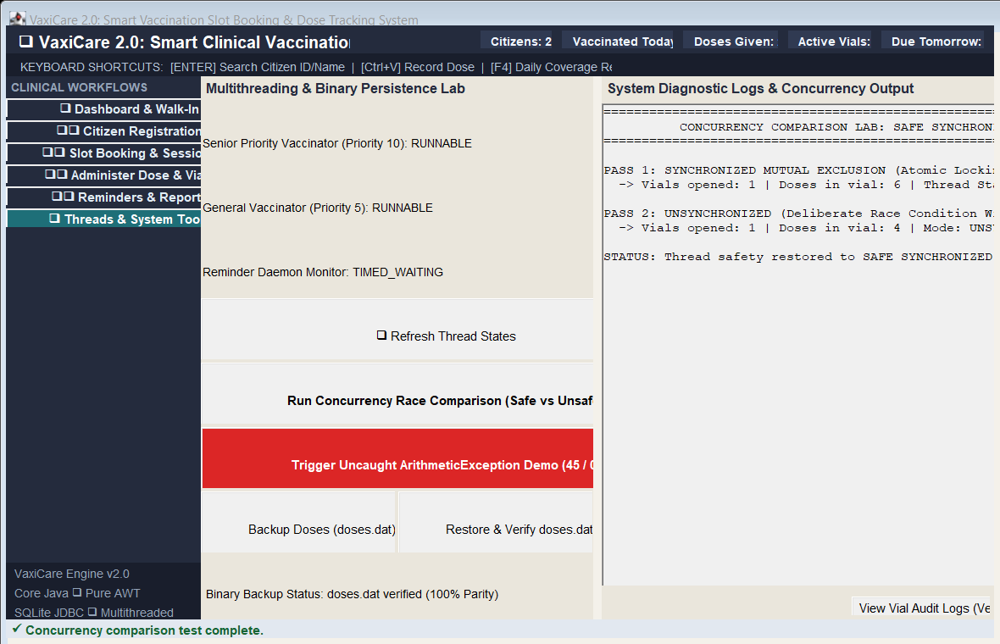
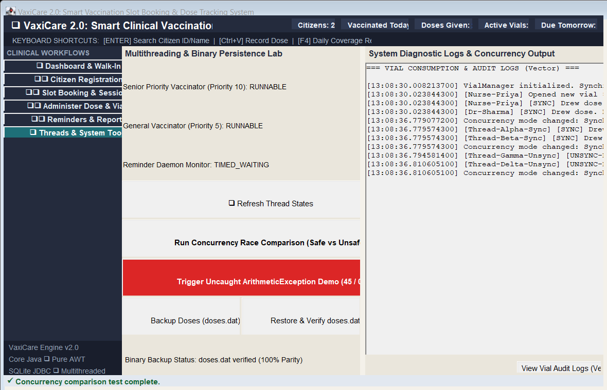

# VaxiCare 2.0: Smart Vaccination Slot Booking & Dose Tracking System


**VaxiCare 2.0** is an upgraded, production-grade clinical vaccination management, slot booking, and inventory tracking system built entirely in **pure Core Java (OpenJDK 21)** using standard Java SE libraries (`java.awt`, `java.io`, `java.sql`, `java.util`, `java.time`) and `org.xerial:sqlite-jdbc`.

It strictly adheres to core Java principles without external UI frameworks (**zero Swing, zero JavaFX**) or build-tool abstractions (**zero Maven, zero Gradle**), serving as an exhaustive reference implementation covering Units I–IV of standard undergraduate Computer Science Java curricula.

---

## ⚡ Quick Start: How to Make It Work (Zero-Friction Startup)

### 1. Prerequisites
- **Java Development Kit**: JDK 21 (or newer). Verify with:
  ```bash
  java -version
  javac -version
  ```
- **Git** (to clone the repository).

### 2. Clone the Repository
```bash
git clone https://github.com/Evilfromblood/VaxiCare.git
cd VaxiCare
```

### 3. One-Click Launchers (Automated Compile & Run)

#### On Windows:
- **Run the GUI Application**: Double-click `run_vaxicare.bat` (or `run.bat`) or run in PowerShell/CMD:
  ```cmd
  run_vaxicare.bat
  ```
  *Compiles all source packages automatically into `out/` if missing, auto-seeds the SQLite database if empty, and launches the centered `1180x760` clinical interface.*
- **Run the Automated Headless Test Suite**: Double-click `verify_vaxicare.bat` (or `verify.bat`) or run:
  ```cmd
  verify_vaxicare.bat
  ```
  *Executes all 8 verification suites (database counts, Sarojini B5531, dynamic dispatch, custom exceptions, binary backup parity, and thread states) and pauses so output is readable.*

#### On Linux / macOS:
```bash
# Grant execution permissions
chmod +x run_vaxicare.sh verify_vaxicare.sh

# Run the GUI Application
./run_vaxicare.sh

# Run Automated Headless Verification
./verify_vaxicare.sh
```

---

## 🛠️ Manual Step-by-Step Compilation & Execution

If you prefer executing commands directly in your terminal without runner scripts:

### Step 1: Compile all Packages into `out/`

**Windows (PowerShell):**
```powershell
if (!(Test-Path out)) { New-Item -ItemType Directory -Path out }
Get-ChildItem -Recurse -Filter *.java src | ForEach-Object { ($_.FullName.Substring($PWD.Path.Length + 1) -replace '\\', '/') } | Set-Content -Encoding ascii sources.txt
javac -d out -cp "lib/*" "@sources.txt"
```

**Linux / macOS (Bash):**
```bash
mkdir -p out
find src -name "*.java" > sources.txt
javac -d out -cp "lib/*" @sources.txt
```

---

### Step 2: Run the Application

#### A. Launch the Graphical User Interface (AWT Desktop App)
```bash
# Windows
java -cp "out;lib/*" com.vaxicare.main.VaxiCareApp

# Linux / macOS
java -cp "out:lib/*" com.vaxicare.main.VaxiCareApp
```

#### B. Run the Comprehensive Headless Test Suite (`--verify`)
```bash
# Windows
java -cp "out;lib/*" com.vaxicare.main.VaxiCareApp --verify

# Linux / macOS
java -cp "out:lib/*" com.vaxicare.main.VaxiCareApp --verify
```

#### C. Run the Uncaught ArithmeticException Demonstration
```bash
# Windows
java -cp "out;lib/*" com.vaxicare.exception.UncaughtDemo

# Linux / macOS
java -cp "out:lib/*" com.vaxicare.exception.UncaughtDemo
```

---

## 🖥️ Live Application Visual Walkthrough

VaxiCare 2.0 features a redesigned **clinical navigation architecture** with a **6-card Left Navigation Rail**, **Top Clinic Status Bar**, and **Bottom Color-Coded Live Feedback Banner**:

```
+-----------------------------------------------------------------------------------------+
| [VaxiCare 2.0: Smart Vaccination Slot Booking]  Citizens: 25 | Booked: 1 | Vials: 1 ... |
| [ENTER] Search ID  |  [Ctrl+V] Record Dose  |  [F4] Coverage Report  |  [ESC] Clear     |
+-------------------+---------------------------------------------------------------------+
| [Dashboard]       |                                                                     |
| [Registration]    |                                                                     |
| [Slot Booking]    |                      ACTIVE WORKSPACE CARD                          |
| [Administer Dose] |                                                                     |
| [Reminders & Rep] |                                                                     |
| [Threads & Tools] |                                                                     |
+-------------------+---------------------------------------------------------------------+
| STATUS: [OK] Form cleared. Ready for new citizen entry. (Live Feedback Banner)          |
+-----------------------------------------------------------------------------------------+
```

### 1. Dashboard & 1-Click Walk-In Wizard (`CardLayout`: `CARD_DASHBOARD`)
The operational nerve center for fast walk-in handling. Operators can search citizens by ID or partial name/phone, preview clinical eligibility in real-time, and complete booking + dose administration in 1 click.



- **Search & Autocomplete**: Search by ID (`B5531`) or partial name (`Sarojini`) without memorizing IDs.
- **⚡ Load Demo Citizen**: One-click button instantly loads verified candidate **Sarojini (B5531)** for viva/lab presentations.
- **Real-Time Eligibility Engine**: Dynamic method dispatch evaluates age thresholds, prior doses, and mandatory wait intervals before booking.
- **1-Click Walk-In Execution**: Performs automatic session allocation, dose decrement, and dose administration in one seamless atomic action.

---

### 2. Citizen Registration (`CardLayout`: `CARD_REGISTRATION`)
Citizen onboarding directory with search filtering and demographic categorization.



- **Demographic Auto-Classification**: Typing age automatically classifies the beneficiary into `Child (0-17)`, `Adult (18-59)`, or `Senior Citizen (60+)`.
- **Search Filter**: Instant filter field reduces the directory list to matching records.
- **AWT MouseAdapter Selection**: Single-clicking any citizen in the list immediately fills the registration form.

---

### 3. Slot Booking & Sessions (`CardLayout`: `CARD_SLOTS`)
Capacity-managed slot reservation and on-the-fly vaccination session creator.



- **Active Session Directory**: Live display of session date, vaccine brand, capacity, booked count, and remaining slots (`int[] slotsRemainingPerSession`).
- **Interactive Session Creator (`+ Create Session in SQLite`)**: Operators can schedule new clinic sessions directly into the SQLite database with custom date, vaccine brand, and capacity.
- **3 Overloaded Booking Dispatches**: Supports manual slot booking (`bookSlot(benId, sessId, vax)`), session booking (`bookSlot(benId, sessId)`), and auto-match (`bookSlot(benId)`).

---

### 4. Administer Dose & Vial Lifecycle Panel (`CardLayout`: `CARD_VACCINATION`)
Physical cold-chain vial inventory monitoring and clinical dose administration.



- **Physical `VialCanvas` Gauge**: Custom pure AWT `Canvas` rendering an animated physical vaccine vial with remaining doses, fluid capacity fill level, and cold-chain shelf-life timers (`VIAL_OPEN_HOURS = 6`).
- **Vial Controls**: Dedicated buttons to **"Open New Vial"** and **"Discard Expired Vial"** with real-time audit logging to `Vector<String>`.
- **Producer-Consumer FIFO Queue (`LinkedList`)**: Visualizes queued citizens waiting for vaccination.
- **Modal Certificate Dialog**: Displays official Certificate (`VC-26-XXXX`) upon vaccination with **"Save Certificate (.txt)"** and clipboard copy options.

---

### 5. Reminders & Daily Coverage Report (`CardLayout`: `CARD_REPORTS`)
Comprehensive reporting hub with automated due-date scanning and dead-candidate purging.





- **Daily Coverage Report (Shortcut `[F4]`)**: Tabulates total citizens, administered doses, brand breakdown, age distribution, and primitive session remaining slots array.
- **Due Tomorrow Reminders**: Scans and displays candidates whose next dose is due tomorrow.
- **Purge Already-Vaccinated (`Iterator.remove()`)**: Demonstrates safe collection modification using explicit `Iterator.remove()` without `ConcurrentModificationException`.
- **Export Report**: Saves clinical summary to timestamped `.txt` files on disk.

---

### 6. Threads, Backup & System Tools Lab (`CardLayout`: `CARD_TOOLS`)
Interactive diagnostic environment designed specifically for viva examination demonstrations.





- **Synchronized vs. Unsynchronized Race Comparison**: One-click side-by-side execution demonstrating safe mutual exclusion vs. race-condition vulnerabilities.
- **Thread Lifecycle Monitor**: Inspects `Thread.getState()` across `RUNNABLE`, `WAITING`, and `TIMED_WAITING` states.
- **Binary Byte-Stream Backup & Parity Verification**: Direct `FileOutputStream` / `FileInputStream` byte serialization using `ByteBuffer` (no character streams). Verifies 100% record parity against SQLite.
- **Uncaught ArithmeticException Trigger**: Triggers JVM default exception handler demonstration (`45 / 0`).

---

## ⌨️ Keyboard Shortcuts Reference

| Shortcut | Context | Function |
| :--- | :--- | :--- |
| **`ENTER`** | Registration / Walk-In Search | Searches citizen by ID or name and populates form fields. |
| **`Ctrl + V`** | Global Application | Immediately administers dose to active candidate and launches certificate dialog. |
| **`F4`** | Global Application | Compiles and switches directly to the Daily Coverage Report. |
| **`ESC`** | Global Application | Clears registration and search input forms. |

---

## 📁 Package & File Breakdown

```
VaxiCare/
├── lib/
│   ├── sqlite-jdbc-3.45.2.0.jar         # SQLite JDBC native driver
│   ├── slf4j-api-2.0.12.jar             # SLF4J logging API
│   └── slf4j-nop-2.0.12.jar             # NOP logger binding
├── src/
│   └── com/
│       └── vaxicare/
│           ├── exception/               # Custom and uncaught exception hierarchy
│           │   ├── VaxiCareException.java       (Base checked exception)
│           │   ├── DoseNotDueException.java     (Interval validation)
│           │   ├── SessionFullException.java    (Capacity validation)
│           │   ├── IneligibleAgeException.java  (Age & booster criteria)
│           │   └── UncaughtDemo.java            (Runtime 45/0 demo)
│           ├── model/                   # OOP domain entities and inheritance
│           │   ├── Schedulable.java             (Interface contract)
│           │   ├── Vaccine.java                 (Abstract base with final certificateNumber)
│           │   ├── ChildVaccine.java            (Pediatric intervals & eligibility)
│           │   ├── AdultVaccine.java            (Adult intervals & minimumAge = 18)
│           │   ├── BoosterVaccine.java          (Final class, primary series check, 180d)
│           │   ├── Beneficiary.java             (Overloaded constructors chained via this)
│           │   ├── Session.java                 (Session capacity model)
│           │   └── DoseRecord.java              (Administered dose record)
│           ├── dao/                     # 100% Parameterized JDBC persistence
│           │   ├── DatabaseManager.java         (Connection & schema lifecycle)
│           │   ├── BeneficiaryDAO.java          (Beneficiaries CRUD)
│           │   ├── SessionDAO.java              (Sessions CRUD)
│           │   ├── DoseDAO.java                 (Doses CRUD)
│           │   └── DataSeeder.java              (Auto-seeds >= 22 bens, 20 sess, 22 doses)
│           ├── threads/                 # Multithreading, priorities & concurrency
│           │   ├── VialManager.java             (Synchronized & unsynchronized vial draw, shelf-life)
│           │   ├── VaccinatorThread.java        (MAX_PRIORITY/NORM_PRIORITY queue workers)
│           │   └── ReminderTask.java            (Runnable background scanner with wait/notify)
│           ├── io/                      # Raw binary byte serialization
│           │   └── BinaryBackupManager.java     (FileOutputStream/FileInputStream via ByteBuffer)
│           ├── service/                 # Business orchestration & Collections
│           │   └── VaxiCareService.java         (7 Collections, 3 overloaded bookSlots, Iterator.remove)
│           ├── ui/                      # Pure AWT Graphical Interface
│           │   ├── VaxiCareFrame.java           (6-Card Layout, Nav Rail, Status Bar, Feedback Banner)
│           │   ├── VialCanvas.java              (Pure AWT Canvas rendering physical vial progress bar)
│           │   └── CertificateDialog.java       (Pure AWT modal certificate dialog with file export)
│           └── main/                    # Application bootstrapper
│               └── VaxiCareApp.java             (Main entry, centered 1180x760 & verification suite)
├── run_vaxicare.bat                     # Recommended Windows 1-click launcher
├── verify_vaxicare.bat                  # Windows 1-click test suite launcher
├── run_vaxicare.sh                      # Recommended Linux/macOS 1-click launcher
├── verify_vaxicare.sh                   # Linux/macOS 1-click test suite launcher
├── doses.dat                            # Binary byte backup file
├── vaccination.db                       # Pre-seeded SQLite database
├── SYLLABUS_MAPPING_TABLE.md             # Complete Java Units I–IV academic mapping
├── PROJECT_REPORT.md                    # Comprehensive technical report
└── README.md                            # Complete user manual
```

---

## ❓ Frequently Asked Questions (FAQ) & Troubleshooting

### 1. How does VaxiCare 2.0 ensure zero Swing or JavaFX?
Every visual component in `com.vaxicare.ui` is imported strictly from `java.awt.*` and `java.awt.event.*`. You will find **zero occurrences** of `javax.swing.*` or `javafx.*` in the entire repository. Dialogs are instances of `java.awt.Dialog`, progress bars are drawn manually on `java.awt.Canvas`, and layouts use `java.awt.CardLayout`, `BorderLayout`, and `GridBagLayout`.

### 2. Can I run VaxiCare in a headless server or container?
**Yes.** If your environment has no graphical display (e.g., GitHub Actions, Linux SSH session, Docker), run:
```bash
java -cp "out:lib/*" com.vaxicare.main.VaxiCareApp --verify
```
The `--verify` flag runs the full suite in headless mode without initializing any AWT display components.

### 3. What happens on the first run if `vaccination.db` does not exist?
`DatabaseManager` automatically creates the tables (`beneficiaries`, `sessions`, `doses`), and `DataSeeder` automatically populates:
- **25 Beneficiaries** (including `Sarojini`, `B5531`, age 64).
- **22 Sessions** across multiple dates and vaccine brands.
- **24 Dose Records** (with exactly 11 scheduled for tomorrow).

### 4. How does the binary backup (`doses.dat`) differ from standard serialization?
It **does not** use `ObjectOutputStream` or `Serializable`. Instead, it uses low-level byte stream encoding:
- 4-byte Magic Number (`0x56415843` / "VAXC")
- 4-byte Record Count
- Each record's fields are manually packed via `java.nio.ByteBuffer` (4-byte integers and 4-byte length-prefixed UTF-8 byte arrays).
- Deserialization is protected by nested `try-catch-finally` blocks and verified against the SQLite record count.

---

## 📚 Academic Syllabus Mapping

For the complete academic syllabus mapping linking every topic in **Java Units I–IV** (Abstraction, Encapsulation, Dynamic Dispatch, Custom Exceptions, Multithreading, AWT Event Delegation, Byte Streams, Collections Framework, and JDBC) directly to specific files and line numbers:

👉 **[SYLLABUS_MAPPING_TABLE.md](SYLLABUS_MAPPING_TABLE.md)**

---

## 📄 License
This project is licensed under the MIT License.
